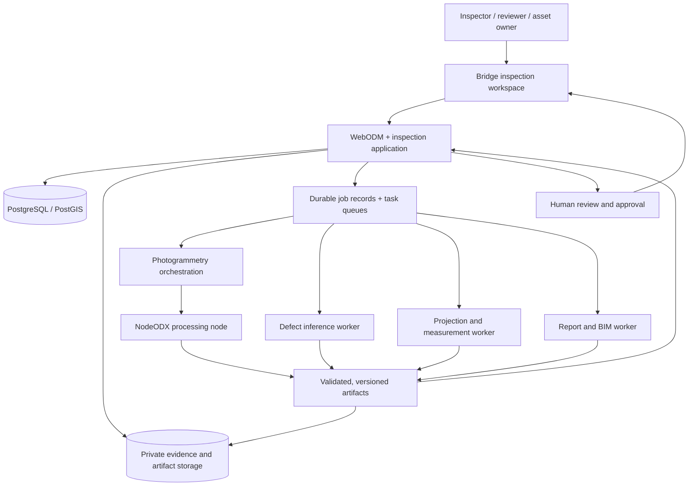
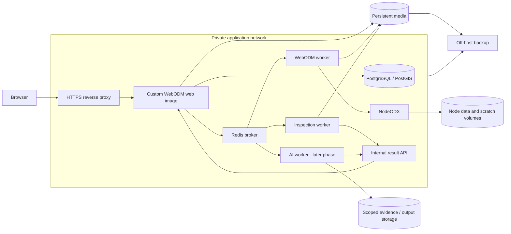
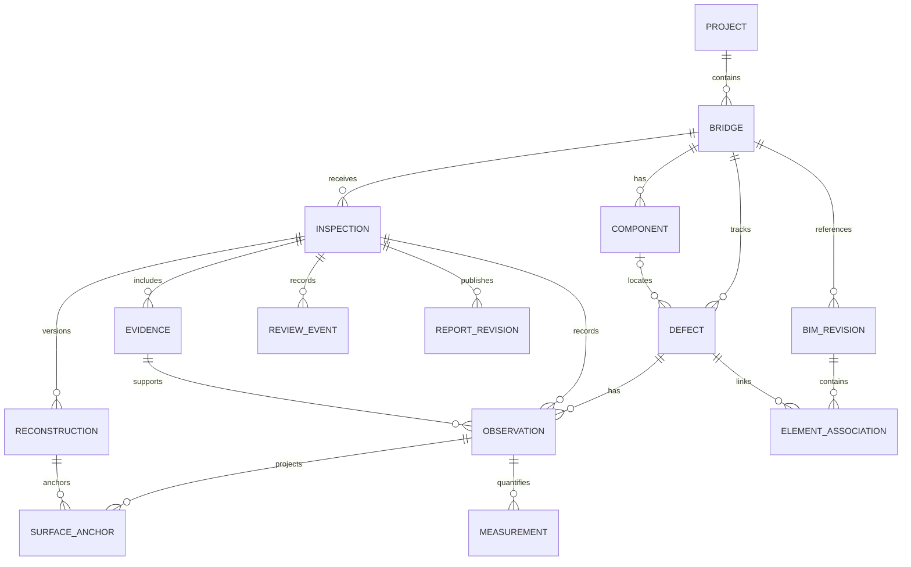

# pmspace.ai Bridge Inspection — System Architecture

**Design date:** 27 October 2026  
**Status:** Proposed architecture; new inspection modules are not implemented yet.  
**Related plan:** [Feature gaps and implementation plan](BRIDGE_INSPECTION_PLAN.md)

## 1. Architecture decision

Build the first release as a **modular Django application extending WebODM**, with separate workers for expensive processing. Reuse WebODM's users, project permissions, photo uploads, reconstruction tasks, maps, and 3D viewer. Add bridge assets, inspections, defect evidence, review, and reports as a dedicated Django app and UI plugin.

Keep AI inference dependencies outside the WebODM web process. Add BIM integration after the inspection workflow and coordinate transformations are validated. Start with one private deployment; introduce organization-level tenancy only with explicit authorization boundaries and isolation tests.

This architecture supports the three proposed product modules:

| Product module | Responsibility | Existing foundation |
| --- | --- | --- |
| Space Capture | Photos → reconstruction → map, mesh, point cloud, camera metadata | WebODM and the configured NodeODX processing service |
| Inspection Core | Original-photo findings, AI suggestions, 3D projection, measurements, human review | New inspection app; reuse existing viewer and permission infrastructure |
| BIM Sync | IFC registration, element associations, exports, asset history | New integration module; phased delivery |

The separate `ODM/` checkout and the running `webodm/nodeodx` service are different execution paths. The installed dashboard currently uses NodeODX. Place processing access behind an adapter so the inspection domain does not depend directly on one engine's directory layout.

## 2. System overview

Solid arrows show data or request flow. The diagram describes the target system, not the current deployment.



**User journey:** select a bridge → create an inspection → upload photographs → process geometry → inspect photos and 3D model → record or review defects → approve findings → export a report or BIM associations.

Manual findings must work before AI is available. A defect can remain a valid 2D observation when its 3D projection is unavailable.

## 3. Current system versus proposed additions

| Component | Current status | Design action |
| --- | --- | --- |
| WebODM web application | Installed; local dashboard and completed bridge task | Extend with the inspection app and UI plugin |
| Database, Redis broker, WebODM worker | Present in Compose | Reuse; add durable inspection records and queue routing |
| NodeODX | Current reconstruction service | Reuse through a task adapter; preserve evidence needed for projection |
| Map, Potree viewer, general measurements | Existing upstream capabilities | Add bridge focus, component navigation, and finding overlays |
| Standalone `viewer/` | Brighton Beach OBJ viewer | Either generalize through an asset manifest or retire after the WebODM workspace replaces it |
| Bridge helper scripts | Fixed task IDs and local paths | Replace with repeatable application actions and configuration |
| Generic object detector | Upstream orthophoto detector for classes such as cars and trees | Do not treat it as concrete-crack segmentation |
| Bridge/component/inspection records | Missing | Add structured models and APIs |
| Defect segmentation and 3D projection | Missing | Add dedicated processing jobs and validation |
| IFC integration and inspection history | Missing | Add after inspection and coordinate foundations |

## 4. Application boundaries

### Browser workspace

Use the existing WebODM React/plugin interfaces for the first release. Provide a bridge list and an inspection page with **Overview, Photos, Map, 3D, Findings, Reports**, and later **BIM**.

- Save a bridge extent and 3D bookmark so opening a task focuses on the bridge.
- Link a selected finding to its source image, component, and any valid surface association.
- Show source-image overlays at original-image coordinates, with display scaling handled separately.
- Clearly distinguish processing status, AI suggestion status, reviewer approval, and repair status.
- Poll durable job state initially. Add streaming updates only if polling becomes a measured limitation.

### Inspection application

Add `WebODM/bridge_inspection/` as a Django app. It owns domain records, authorization, job submission, review transitions, report requests, and artifact manifests. Register models and migrations explicitly; a WebODM UI plugin does not automatically provide this database integration.

Use `WebODM/plugins/bridge-inspection/` for UI hooks and plugin assets. Keep business rules in the Django app rather than in browser code or generic plugin settings.

The application is the only writer of authoritative inspection records. Heavy workers return versioned result manifests; they do not directly approve findings or modify inspection tables.

### Processing adapters

| Boundary | Input | Output | Important rule |
| --- | --- | --- | --- |
| Capture adapter | Authorized photo manifest, processing profile | WebODM task reference and reconstruction bundle | Track actual engine/version and preserve calibration/poses before cleanup |
| Inference adapter | Original-image references, model/version, preprocessing settings | Masks, classes, confidence, provenance | Suggestions require review; never substitute reduced navigation photos silently |
| Geometry adapter | Mask, camera model/pose, mesh and transform versions | Surface association, quality flags, supported measurements | Reject unsupported projection or precision |
| BIM adapter | IFC revision, reconstruction, reviewed registration | GlobalId associations and new export revision | Retain original IFC and coordinate metadata |
| Report adapter | Approved evidence snapshot | PDF and machine-readable findings | Report version must identify the evidence and model versions used |

## 5. Container and deployment design

### Initial deployment

Use Docker Compose on a persistent host. The database and processing services stay on private networks. Expose the application through one HTTPS entry point; keep local development bound to loopback.



The internal result API is a route on the web application, not another required service. Workers use service credentials scoped to job/result operations. Only the existing WebODM worker and the new trusted inspection worker need Django/database access; the isolated AI worker reports through the API.

Build a custom WebODM image containing the inspection app, plugin assets, and settings changes. Use the same application image/version for web and Django workers, with different commands and queue subscriptions. The current Compose files use upstream images; editing the local source alone will not install a new Django app in those containers.

### Storage rollout

1. **First release:** retain WebODM's filesystem media volume and node scratch volumes; add immutable evidence and manifest conventions.
2. **Later scale:** move new evidence/archive assets behind an object-storage interface with scoped reads/writes. Implement staging and result transfer for processing workers.
3. **Do not assume** replacing WebODM's media directory with an object-store URL makes its tiling and filesystem operations work. Preserve required local files/caches until adapters are tested.

Move AI or photogrammetry workers to separate hosts when resource measurements justify it. Size CPU, memory, disk, and optional GPU from representative workloads; the current sample is not a production capacity benchmark.

### Optional Vercel frontend

A separate Vercel frontend can be considered later for a public viewer or custom portal. Keep the persistent processing backend separately reachable through HTTPS, with explicit authentication and upload/download authorization. Start with the integrated WebODM UI to avoid maintaining two frontends and two authentication flows. No Vercel-specific deployment is required for the initial architecture.

## 6. Data ownership and model

The database owns identities, permissions, state, associations, and provenance. File storage owns large immutable photos, masks, models, and reports. Redis transports work; it is not the system of record for job completion.



Key model rules:

- **Bridge** belongs to an existing authorized WebODM project. Components are stable bridge elements.
- **Inspection** represents one visit/capture session. It can contain multiple reconstruction attempts and approved versions.
- **Defect** is a stable bridge-level identity. An **Observation** records its evidence in one inspection. This distinction supports later comparison without changing historical evidence.
- **Evidence** stores the file hash, original dimensions/orientation, capture metadata, ownership, and authorized storage reference. Image variants retain a reversible transform to original pixels.
- **Reconstruction** includes the WebODM task UUID, engine/version, option manifest, mesh/cloud hashes, camera bundle, CRS, origin, units, and quality summary.
- **SurfaceAnchor** references one reconstruction version and records a point or mesh triangle/barycentric location plus quality. A new mesh requires revalidation.
- **Measurement** stores value, unit, method, uncertainty, calibration reference, and supported resolution. A missing value is preferable to unsupported precision.
- **ReviewEvent** records actor, time, decision, rationale, and subject version. Approved evidence/report snapshots remain immutable; corrections create revisions.
- **BIMRevision** retains the original IFC hash, schema/units, registration transform and approval. Element associations use IFC GlobalIds within a specific revision.
- **Job / JobAttempt / Artifact / OutboxEvent** support durable execution, retries, result validation, and publication. These operational tables are omitted from the domain diagram for readability.

Apply project authorization to all relations and file downloads. A future Organization model must be enforced through the whole record graph; adding an organization field alone is insufficient isolation.

## 7. Processing workflow

```mermaid
sequenceDiagram
    actor Inspector
    participant App as Inspection application
    participant DB as Database / outbox
    participant Capture as WebODM / NodeODX
    participant Worker as Inspection / AI workers
    participant Store as Private artifact storage
    actor Reviewer
    Inspector->>App: Create inspection and upload photos
    App->>Store: Save originals and hashes
    App->>DB: Record evidence, job and outbox event
    App->>Capture: Submit authorized reconstruction
    Capture-->>App: Task progress / completed artifacts
    App->>Store: Verify reconstruction and camera bundle
    App->>DB: Publish reconstruction version
    Inspector->>App: Add manual findings or request AI analysis
    App->>Worker: Versioned job with scoped artifact references
    Worker->>Store: Read evidence; write staged results
    Worker-->>App: Result manifest and input versions
    App->>DB: Validate and ingest suggestions idempotently
    Inspector->>App: Inspect evidence and submit findings
    Reviewer->>App: Accept / reject with rationale
    App->>DB: Record approved revision
    App->>Worker: Generate report / optional BIM export
    Worker-->>App: Validated export manifest
    App-->>Inspector: Authorized report and model links
```

The diagram simplifies delivery: a dispatcher publishes committed outbox events and workers consume queued jobs. Reconstruction and inference can run independently after evidence validation; 3D projection waits for both a suitable observation and validated geometry.

### Durable execution

Job state: `queued → running → validating → succeeded`, with explicit `failed`, `cancel_requested`, and `cancelled` transitions.

- Commit a job and its outbox event in one database transaction. Retry publication safely if the broker is unavailable.
- Route existing WebODM work and new inspection work to separate queues. Explicitly configure task registration and subscriptions so the upstream worker does not consume unknown inspection tasks.
- AI workers use their own image and registered task handlers; exchange JSON contracts, not serialized executable objects or arbitrary code.
- Use at-least-once delivery with idempotent processing/result ingestion. An idempotency key includes project, action, input hashes, model/version, and relevant parameters.
- Record each attempt, heartbeat, lease, cancellation intent, and error classification. A reconciler identifies stale attempts and determines whether retry is safe.
- Stage outputs under an attempt-specific location. Validate checksums, expected input versions, file formats, units, and required files before publishing a result manifest.
- A duplicate or late callback cannot overwrite approved records or attach results to a superseded model.
- Do not automatically delete evidence after worker failure. Retain scratch by policy and reclaim only verified disposable files.

## 8. Geometry and measurement contract

Maintain explicit transformations through this chain:

```text
original image pixels
  → EXIF/display orientation and processing variant
  → calibrated / undistorted camera coordinates
  → reconstructed camera pose
  → reconstruction local coordinates
  → projected CRS / vertical reference
  → viewer coordinates or approved BIM registration
```

Store conventions and versions for every transform: units, axes, handedness, image dimensions, camera model, origin offsets, and matrix direction. Do not infer these from a filename.

Project a mask by casting calibrated camera rays onto a suitable surface. Check visibility, depth agreement, incidence angle, missing geometry, and registration quality. Keep the original mask even when projection fails. Support a separately labeled manual spatial marker.

The current Rivaz demo reports approximately 8.23 cm average GSD and a 15 cm orthophoto pixel size. It cannot validate the presentation's 0.2 mm crack target. Keep **detection capability**, **measurement uncertainty**, and **geometry accuracy** as separate quality fields. Enable fine-width measurement only for capture/calibration methods validated against independent ground truth.

## 9. API boundaries

Proposed namespace: `/api/inspection/v1/`. These routes are design contracts and are not currently implemented.

| Route family | Purpose |
| --- | --- |
| `/bridges`, `/bridges/{id}/components` | Authorized asset inventory |
| `/inspections`, `/inspections/{id}/evidence` | Inspection sessions and original evidence |
| `/inspections/{id}/reconstructions` | Create/reference versioned WebODM runs |
| `/inspections/{id}/analysis-jobs` | Request defect analysis with explicit model/version |
| `/jobs/{id}`, `/jobs/{id}/cancel` | Durable progress and cancellation |
| `/defects`, `/defects/{id}/observations` | Stable defects and inspection-specific evidence |
| `/observations/{id}/projections` | Request and retrieve spatial associations |
| `/review-events` | Permission-controlled review transitions |
| `/inspections/{id}/reports` | Generate/access versioned reports |
| `/bridges/{id}/bim-revisions` | IFC evidence and registration workflow |
| `/internal/jobs/{id}/results` | Scoped worker result ingestion |

Use existing same-origin session authentication and CSRF protections for the integrated UI. Add narrowly scoped service authentication for workers. Check authorization on each request, including downloads. Require record-version checks for concurrent edits and explicit idempotency on job creation/result callbacks. Validate uploads by content/size and maintain safe server-generated storage paths.

## 10. Reliability and data protection

The previous disk exhaustion is a concrete requirement for the design:

- **Capacity admission:** reserve capacity for source files, processing intermediates, result packaging, and exports. Check both worker-local and application storage. Serialize capacity reservations so concurrent submissions cannot each spend the same free space.
- **Resource isolation:** set separate concurrency and memory/CPU limits for web, reconstruction, AI, and report jobs; prioritize interactive application health.
- **Reconstruction recovery:** reconcile application task references with processing-node tasks. If scratch is lost, resubmit from preserved evidence and create a new attempt/version rather than claiming a checkpoint resume.
- **Backups:** coordinate database snapshots with media/artifact manifests, retain off-host copies, and perform isolated restore drills. Back up encryption keys/secrets through the deployment's protected secret mechanism.
- **Access:** keep database, broker, node APIs, and worker endpoints private. Scope file access and audit evidence exports and review decisions.
- **Retention:** separate immutable originals, approved reports, model versions, disposable derivatives, and scratch. Document what can be recomputed and what must be retained.
- **Observability:** correlate inspection, task, job, attempt, and artifact IDs. Alert on capacity, stale jobs, node loss, failed backups, and output validation failures. Exclude credentials and private source URLs from logs.

## 11. Suggested repository layout

Paths marked `new` are proposed additions.

```text
Drone project/
├── ARCHITECTURE.md
├── BRIDGE_INSPECTION_PLAN.md
├── WebODM/
│   ├── app/                         existing task, project, viewer foundation
│   ├── bridge_inspection/           new Django domain app
│   │   ├── models/                  assets, inspections, findings, jobs
│   │   ├── api/                     serializers, views, permissions
│   │   ├── services/                review, orchestration, publication
│   │   ├── adapters/                WebODM tasks, artifact storage
│   │   ├── jobs/                    projection, reports, BIM handlers
│   │   ├── migrations/
│   │   └── tests/
│   ├── plugins/bridge-inspection/   new workspace UI and viewer hooks
│   └── webodm/settings_override.py  explicit app/settings integration
├── services/defect-inference/       new isolated inference worker image
│   ├── contracts/
│   ├── models/                      model adapters; weights stored separately
│   ├── tasks/
│   └── tests/
├── contracts/                      new versioned job/artifact schemas
├── deployment/                     new image builds, Compose, runbooks
├── tests/fixtures/inspection/       new small licensed validation fixtures
├── ODM/                            standalone upstream engine checkout
├── viewer/                         current separate local demo viewer
└── outputs/                        current demo exports; not production storage
```

Do not commit private evidence, model weights, credentials, or generated production artifacts as application source. Maintain small licensed fixtures for reproducible checks.

## 12. Architecture decisions and validation gates

| Decision | Reason | Revisit when |
| --- | --- | --- |
| Integrated Django app and plugin | Reuses authentication, projects, viewers, and deployment | Separate release cycles or product requirements justify a standalone portal |
| Database-backed job state and outbox | Results and recovery remain traceable across broker/worker failures | No planned replacement; tune implementation to measured load |
| Separate AI worker image | Avoids model/runtime dependencies in the web process | Model serving needs independent scaling or multiple accelerators |
| Filesystem storage first | Matches the installed WebODM media behavior | Remote workers or archive growth justify tested object-storage adapters |
| Original evidence and versioned transforms | Required for reproducible projection and measurements | Retention policy changes; approved evidence remains traceable |
| Human approval of findings | AI output and calibrated measurements need accountable review | Any automation policy must have its own validation and authorization |
| IFC associations before bidirectional sync | Makes alignment and element identity testable in a limited pilot | Receiving BIM tools and revision/conflict rules are agreed |

Before implementation, verify plugin loading/build behavior, Django app migration compatibility, task registration, and the complete camera/pose bundle exported by the processing node. Inspect repository and model/data licenses before distribution; this design does not establish a licensing conclusion.

## 13. Build order

1. **Foundation:** custom image, inspection app skeleton, permissions, job records, evidence manifests, capacity checks, and restore test.
2. **Manual inspection MVP:** bridge/component inventory, direct bridge view, original-photo annotation, reviewer workflow, and report snapshots.
3. **AI pilot:** one validated defect class, isolated worker, suggestion review, reproducible model/input manifests.
4. **Spatial analysis:** validated camera transforms, 2D-to-3D associations, supported measurements and uncertainty.
5. **BIM pilot:** IFC revision storage, reviewed alignment, GlobalId associations, receiving-tool export validation.
6. **Lifecycle and scale:** repeat-inspection comparison, repair tracking, organization isolation if required, remote workers and archive storage.

Each phase should leave a usable application. Phase 2 delivers an inspection workflow without depending on unproven AI accuracy. The detailed acceptance criteria are in [BRIDGE_INSPECTION_PLAN.md](BRIDGE_INSPECTION_PLAN.md).

## 14. Local evidence for this design

- [Current Compose services](WebODM/docker-compose.yml) and [processing node](WebODM/docker-compose.nodeodm.yml)
- [Local deployment override](WebODM/docker-compose.local.yml)
- [Application settings extension points](WebODM/webodm/settings.py)
- [Celery setup](WebODM/worker/celery.py)
- [Existing project permissions](WebODM/app/models/project.py)
- [Task processing and asset definitions](WebODM/app/models/task.py)
- [Generic object detector](WebODM/coreplugins/objdetect/api.py)
- [Completed bridge statistics](outputs/rivaz-bridge/processing-summary.json)

This document proposes the architecture only. It does not modify the running dashboard, provision cloud resources, or implement the new modules.
