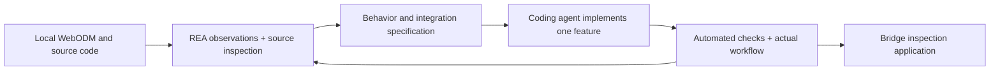

# Building the bridge inspection system with REA

Date: 27 October 2026  
Status: setup and development workflow; REA has not been installed or connected by this task.

## 1. How REA fits this project

Use REA to investigate the existing application's behavior and produce evidence that guides implementation. The coding agent then edits, tests, and integrates the missing inspection features described in [ARCHITECTURE.md](ARCHITECTURE.md) and [BRIDGE_INSPECTION_PLAN.md](BRIDGE_INSPECTION_PLAN.md).



REA is a development tool, not a production processing service. Start with your own WebODM instance at `http://localhost:8000` and the source in `WebODM/`. Since the source is available, read the Django backend directly and use browser observations to verify the UI/API behavior. Native executable decompilation is not required for this initial workflow.

Inspection of a remote website can reveal browser-delivered code and observable requests/responses; it does not reveal an inaccessible server's complete implementation, private model weights, or training data. A reconstructed interface or replay environment is not evidence of a functioning inspection backend.

## 2. Connect REA

The local Node.js executable currently reports `v24.18.0`. REA's setup guide currently lists `24.22.1+` for the Node 24 branch. Update to a supported Node.js release before setup. Use the [official Node.js download page](https://nodejs.org/en/download) and check the current [REA setup requirements](https://rea.tools/get-started/).

In PowerShell, for a Codex client:

```powershell
cd "C:\Users\vivom\Drone project"
node --version
npx.cmd rea-agents@latest setup --client codex
```

Review the installer's configuration plan, complete setup, and restart the coding client. Choose the client you actually use if it differs. Then run:

```powershell
npx.cmd -y rea-agents@latest doctor --client codex --json
```

Ask the agent to list its connected REA tools. A successful installer invocation alone does not verify that the active agent session can use them. These commands and the client connection process are documented in the [REA setup guide](https://rea.tools/get-started/).

REA's [browser guide](https://rea.tools/guides/browser/) uses an existing Chrome/Chromium/Edge debugging session with a separate browser profile. Follow that guide to connect the local WebODM tab and provide the local debugging endpoint to the agent. Keep the debugging interface local. Use a dedicated test account/profile and keep credentials out of saved investigation artifacts.

## 3. Establish the reference workflow

Use the completed Rivaz task as the first reference rather than starting another expensive reconstruction:

- Project: `3`
- Task: `5dcfa7d7-7bb7-475e-81b3-20d7047548e0`
- Map: `http://localhost:8000/map/project/3/task/5dcfa7d7-7bb7-475e-81b3-20d7047548e0/`
- 3D: `http://localhost:8000/3d/project/3/task/5dcfa7d7-7bb7-475e-81b3-20d7047548e0/`
- Exported example: `outputs/rivaz-bridge/`

These are investigation references, not identifiers to hardcode into the new product.

Trace one feature at a time:

| Investigation | Evidence to capture | Implementation decision it supports |
| --- | --- | --- |
| Open a project/task | UI handler, request, response, permission check | Where the inspection workspace links to WebODM |
| Open a map or 3D view | Asset URLs, metadata, CRS/origin, camera/bookmark behavior | How to focus the bridge and display findings |
| Upload a small test survey | Upload API, task creation, state changes, failure handling | How inspections submit and track processing |
| Save a measurement/annotation | UI events, persistence endpoint, serialization | Which viewer hooks can support defect evidence |
| Download results | Authorization, asset definitions, file formats | How reports and evidence manifests reference artifacts |

Do not infer a server-side implementation solely from a browser response. Link runtime observations to source files where available and explicitly mark unresolved behavior.

## 4. First investigation prompt

After REA is connected, give the coding agent this prompt:

```text
Read ARCHITECTURE.md and BRIDGE_INSPECTION_PLAN.md.

Use the available REA browser tools and direct source inspection to investigate
our local WebODM instance at http://localhost:8000 and code in WebODM/.

Start with the completed Rivaz bridge task:
5dcfa7d7-7bb7-475e-81b3-20d7047548e0, project 3.

Trace opening the task, loading its map and 3D model, saving a viewer camera
position or measurement where supported, and downloading an existing result.
Use the configured browser-debugging endpoint. If no endpoint is connected,
report that limitation and continue with source inspection.

For each feature, record UI entry point, request/response contract, backend
handler, permission enforcement, database/file persistence, and error cases.
Label findings as source-confirmed, runtime-observed, inferred, or unverified.
Preserve existing survey results and exclude credentials from captured evidence.

Write docs/reverse-engineering/WEBODM_INTEGRATION_MAP.md with file/line
references and reproducible observations. Identify integration points for the
inspection workspace. Do not treat the generic object detector as a crack model.
```

## 5. Build a complete vertical workflow first

The first usable release should let a person complete:

**Bridge → inspection → existing reconstruction → source photo → manual defect → reviewer decision → report.**

Implement this before introducing AI and BIM. It establishes the records, permissions, evidence, and user workflow that those modules depend on.

Suggested implementation prompt:

```text
Use ARCHITECTURE.md, BRIDGE_INSPECTION_PLAN.md, and the verified integration map.
Implement the first manual bridge inspection release in this workspace.

Reuse WebODM authentication, project permissions, tasks, map, and 3D viewer.
Add the inspection Django app and UI integration described in the architecture.
Create bridge/component/inspection records, original-photo manual annotations,
findings, reviewer decisions, and versioned report export.

Include storage preflight and evidence manifests for newly submitted jobs.
Connect the new code through a custom application image and migrations; do not
assume changing local source changes the currently running upstream image.

Use separate test records. Add meaningful permission, review-transition,
annotation-coordinate, and report-provenance tests. Verify the actual browser
workflow, including a denied-access case and a failed job state.

Keep job and model identifiers configurable. Finish with launch instructions,
test results, and an honest list of remaining features.
```

## 6. Add the remaining modules in stages

| Stage | REA/source investigation | New engineering work | Completion gate |
| --- | --- | --- | --- |
| Reliable foundation | Trace uploads, restart behavior, asset publication, and cleanup | Capacity reservations, evidence manifests, recoverable job attempts | Controlled interruption and restore preserve evidence |
| Manual inspection | Trace viewer hooks and project authorization | Inventory, photo annotations, review, report snapshots | An inspector and reviewer complete the full workflow |
| AI defect pilot | Inspect the existing detector's integration pattern and background jobs | Licensed labeled data, segmentation model, isolated inference worker, suggestion review | Held-out validation and reproducible model/input versions |
| 3D projection | Trace camera metadata, viewer transforms, and mesh coordinates | Calibration-aware ray projection, visibility checks, surface associations | Independent target checks and correct rejection of unsupported cases |
| Measurements | Inspect existing measurement units and persistence | Original-image scale, surface measurements, uncertainty and resolution gates | Known dimensions meet agreed tolerances |
| IFC/BIM | Inspect accessible import/export examples and the selected receiving workflow | IFC revisions, reviewed registration, GlobalId associations, export | Export reopens with correct alignment, identity, and units |
| Lifecycle and deployment | Trace state transitions, access checks, failure recovery | Repeated inspections, repair tracking, audit history, production operations | End-to-end acceptance and backup/restore drill |

For each stage: investigate → document the contract → implement → test → verify with real inputs. Keep recorded UI behavior tests separate from tests proving reconstruction, inference, projection, and report generation actually run.

## 7. Deliverables to retain

Proposed development artifacts:

```text
docs/reverse-engineering/
  WEBODM_INTEGRATION_MAP.md
  UI_API_CONTRACTS.md
  COORDINATE_CONVENTIONS.md
  VERIFIED_BEHAVIORS.md
  UNRESOLVED_QUESTIONS.md

contracts/
  inspection-job.schema.json
  artifact-manifest.schema.json
  defect-observation.schema.json

tests/
  integration/
  permissions/
  geometry/
  fixtures/inspection/
```

Keep observed facts separate from proposed schemas. Each investigation should identify the inspected application version, inputs, action, observed output, and source references. Use small sanitized fixtures rather than credential-bearing traffic captures.

## 8. What REA cannot complete on its own

- A validated crack detector still needs suitable imagery, labels, a model, and held-out evaluation.
- 2D-to-3D projection still needs calibrated cameras, poses, a suitable surface, and explicit transforms.
- The 0.2 mm target still requires capture and dimensional validation. The current Rivaz navigation sample does not demonstrate it.
- IFC integration still needs a supported schema, coordinate alignment, and receiving-tool verification.
- A complete service still needs persistent storage, recoverable jobs, authorization, and tested deployment.

Use REA to reduce uncertainty about existing behavior. Use the architecture and acceptance tests to determine whether the new system is complete.

## Sources

- [REA overview](https://rea.tools/): role of inspection and feature reconstruction.
- [REA setup](https://rea.tools/get-started/): runtime prerequisites, client setup, and connection checks.
- [REA browser guide](https://rea.tools/guides/browser/): connecting a debugging session and observing actions.
- [Project architecture](ARCHITECTURE.md) and [feature plan](BRIDGE_INSPECTION_PLAN.md): proposed product boundaries and acceptance criteria.
